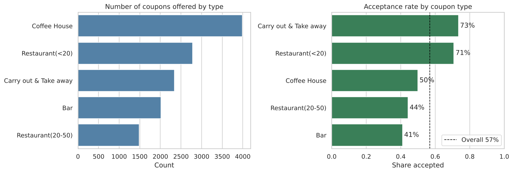
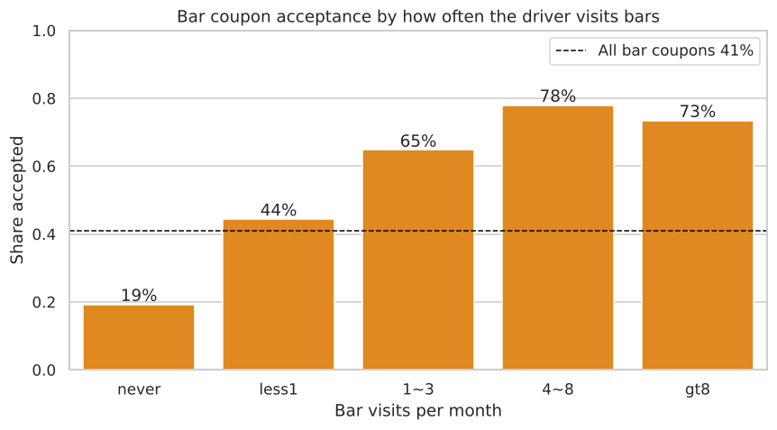
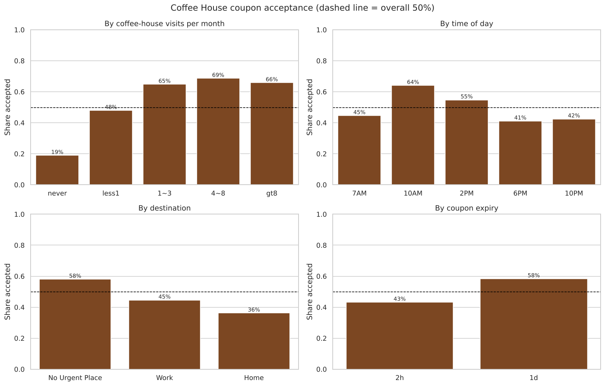

# Will a Driver Accept the Coupon?

**Practical Application 1 – UC Berkeley Professional Certificate in Machine Learning & Artificial Intelligence**

Full analysis: [`coupon_acceptance_analysis.ipynb`](coupon_acceptance_analysis.ipynb)

## The business question

Amazon is considering a service that sends drivers targeted coupons for food and drink venues along their route. Would drivers use them? Does it matter what kind of venue, when the coupon arrives, or who is in the car?

This analysis uses survey data from the UCI Machine Learning Repository (collected on Amazon Mechanical Turk), in which about 12,600 responses describe a driving scenario and whether the driver would accept the coupon offered.

## Data preparation

- Removed the `car` column (missing for 99% of responses) and one column that had the same value for everyone.
- Removed 74 duplicate responses.
- Filled the small number of missing "how often do you visit…" answers (under 2% per column) with the most common answer.

## Key findings

**1. Overall, 57% of coupons are accepted, but the coupon type matters a lot.**

Cheap restaurant (71%) and carry-out (73%) coupons convert well. Bar (41%) and expensive-restaurant (44%) coupons convert poorly.

**2. Existing habit is the strongest predictor.**

People who already visit a bar at least once a month accept bar coupons 65–78% of the time, compared with 19% for people who never go to bars. Coffee houses show the same pattern: 65–69% for regular visitors versus 19% for those who never go.

**3. Who accepts bar coupons:** regular bar-goers, especially those **under 30** and **without children in the car** (71–72% acceptance, against about 30% for everyone else). Income and cheap-restaurant habits make little difference.

**4. Who accepts coffee house coupons:** regular coffee drinkers on a **non-urgent trip** at **10 AM–2 PM**, who accept **77%** of offers. Acceptance is also higher when travelling with friends or a partner, and with a **1-day** rather than a 2-hour expiry (58% vs 43%). It is lowest on the way home, in the evening, and when the coffee house is 25+ minutes away.

**5. Context helps:** warmer weather (60% acceptance at 80°F vs 53% at 30°F) and shorter detours both increase acceptance.

## Recommendations

1. **Target by habit.** Send bar and coffee coupons mainly to drivers who already visit those venues. Offers to people who never go are accepted less than 20% of the time.
2. **Lead with low-cost offers.** Cheap restaurants, carry-out and coffee give the best return per coupon sent.
3. **Time it right.** Push coffee coupons between 10 AM and 2 PM on non-urgent trips, and avoid the morning commute and late evening.
4. **Default to 1-day expiry** for coffee coupons.
5. **Suppress bar coupons when children are in the car**, and keep venues within a short detour.

## Verdict

The idea works, **but only if it is targeted.** Sending coupons to everyone would waste a large share of offers. Using a driver's habits and trip context lifts acceptance from about 50% to 70–77% in the best segments.

## Next steps

- Build a classification model (for example logistic regression or a decision tree) to score each driver–coupon pair in real time.
- Run an A/B test of the targeting rules above against untargeted delivery before a full rollout.
- Extend the analysis to the carry-out and restaurant coupon groups.

## Repository contents

| File | Description |
|---|---|
| `coupon_acceptance_analysis.ipynb` | Full analysis: data cleaning, visualisations, bar-coupon questions, coffee-house investigation, findings |
| `coupons.csv` | Survey dataset (UCI Machine Learning Repository) |
| `*.png` | Charts used in this report |
